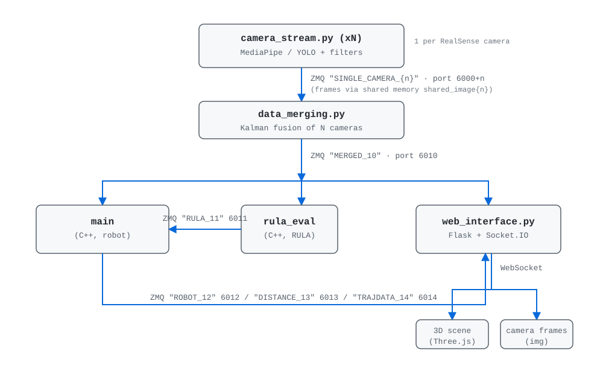

# SkeletonTracking

Multi-camera real-time human skeleton tracking with ergonomic (RULA) evaluation and a live 3D web visualization of a Franka Panda robot.

The system streams skeletons from one or more Intel RealSense cameras, fuses them into a single multi-person skeleton, computes Rapid Upper Limb Assessment (RULA) ergonomic scores, and displays everything in a browser. When robot simulation is enabled, a C++ trajectory executor publishes the robot state so the human skeleton and robot can be rendered side by side in a shared 3D scene.

## Architecture



**Communication protocol** (implemented in `scripts/utils/data_transmitter.py` and `include/data_transmitter.hpp`):

| Data               | Topic             | Port  | Sender              | Receiver             |
|--------------------|-------------------|-------|---------------------|----------------------|
| Per-camera skeleton| `SINGLE_CAMERA_{n}` | `6000+n` | `camera_stream.py` / `data_recording.py --stream` | `data_merging.py`, `web_interface.py` |
| Merged skeleton    | `MERGED_10`       | `6010` | `data_merging.py`   | `main`, `rula_evaluation`, `web_interface.py` |
| RULA scores        | `RULA_11`         | `6011` | `rula_evaluation`   | `web_interface.py`  |
| Robot state        | `ROBOT_12`        | `6012` | `main` (robot mode) | `web_interface.py`, `robot_controller_ros2` |
| Min. distance      | `DISTANCE_13`     | `6013` | `main` (robot mode) | `web_interface.py`  |
| Trajectory data    | `TRAJDATA_14`     | `6014` | `main` (robot mode) | `web_interface.py`  |
| Waypoint stream    | `WAYPOINT_15`     | `6015` | `main` (robot mode) | `robot_waypoint_bridge` |

Camera frames are exchanged out-of-band through POSIX shared memory segments named `shared_image{n}` (480×848×3), referenced by `device_id`.

## Directory structure

```
.
├── CMakeLists.txt              # C++ build configuration
├── run.sh                      # Main launcher (all-in-one entry point)
├── launch/
│   └── real_robot.launch.py    # ROS 2 bringup for the real Franka Panda
├── include/                    # C++ headers
│   ├── data_transmitter.hpp    # ZMQ + shared memory communication
│   ├── robot_model.hpp         # Pinocchio kinematics wrapper
│   ├── SSMPFL.hpp              # Safe-Stop + Position/Force-Limiting QP solver
│   ├── minDistance.hpp         # Point/segment geometry primitives
│   ├── rula_score_computation.hpp
│   ├── trajectory_utils.hpp    # CSV waypoints + quintic p2p trajectory
│   ├── trajectory_loader.hpp   # Trajectory sets read from src/trajectories
│   ├── trajectory_publisher.hpp# Publication of the robot state to web_interface.py
│   ├── skeleton_reader.h       # Reception of the merged skeleton
│   ├── flag_stop.h             # Safe-Stop decision + robot capsules
│   ├── calc_stop_duration.h    # CasADi stop-duration optimizer
│   ├── ik_solver.h             # LM inverse kinematics
│   ├── geometry.h              # Segment/segment distance primitives
│   ├── shared_state.h          # Shared state between the playback and the collision threads
│   └── utils.hpp               # JSON → keypoint conversion
├── src/
│   ├── main.cpp                # Robot trajectory executor (robot mode)
│   ├── main_SSM.cpp            # Safe-Stop-Monitor robot trajectory executor
│   ├── main_SSMPFL.cpp         # Safe-Stop + Position/Force-Limiting executor
│   ├── main_SSMPFLescape.cpp   # Safe-Stop + Position/Force-Limiting executor (escape)
│   ├── trajectory_loader.cpp   # Loader of the trajectory sets in src/trajectories
│   ├── rula_evaluation.cpp     # RULA scoring executable
│   ├── robot_controller_ros2.cpp # ROBOT_12 stream → FollowJointTrajectory (real robot)
│   ├── rula_score_computation.cpp
│   ├── robot_model.cpp
│   ├── SSMPFL.cpp
│   ├── trajectory_utils.cpp
│   ├── urdf/panda.urdf         # Franka Panda robot model
│   └── trajectories/test1/     # Recorded joint trajectories (q/qd/qdd/ref)
└── scripts/
    ├── camera_stream.py        # Per-camera skeleton tracking (RealSense)
    ├── data_merging.py         # Multi-camera Kalman fusion
    ├── data_recording.py       # Record to disk / replay (`-r`/`-s`)
    ├── web_interface.py        # Flask + Socket.IO server feeding the browser
    ├── calibration.py          # Camera↔world ArUco calibration
    ├── utils/                  # data_transmitter, kalman_filter, filters,
    │                           # skeleton_tracker, marker_detector, ...
    ├── mediapipe_utils/        # Standalone MediaPipe demos
    ├── flask_utils/            # Web UI (index.html, js/, style, meshes/)
    ├── models/                 # MediaPipe/YOLO model files
    └── data/                   # Calibration poses, logs, recorded skeletons
```

## Requirements

**Hardware**
- One or more Intel RealSense cameras (USB). Camera count is auto-detected via `lsusb` (Vendor ID `8086`).
- (For calibration only) a printed ArUco marker (ID 34, `DICT_6X6_250`).

**Python** (`pip install`)
- `pyrealsense2`, `ultralytics`, `opencv-python`, `numpy`
- `mediapipe`, `zmq`, `flask`, `flask-socketio`
- `pandas`, `pyyaml` (recording/training)

**C++ build**
- CMake ≥ 3.10, C++17 compiler
- Eigen3, nlohmann-json, qpOASES, Pinocchio (with URDF + CasADi support, optional)
- ZeroMQ (`libzmq`)

## Build

```bash
mkdir -p build && cd build
cmake .. -DCMAKE_BUILD_TYPE=Release
make -j$(nproc)
cd ..
```

This produces the following executables in `build/`:

| Executable            | Purpose                                                            |
|-----------------------|--------------------------------------------------------------------|
| `build/main_SSM`      | Safe-Stop-Monitor robot executor: loads the trajectory from `src/trajectories`, receives the merged skeleton and publishes the computed trajectory (only used with `--robot --core SSM`) |
| `build/main_SSMPFL`   | Safe-Stop + Position/Force-Limiting robot executor (`--core SSMPFL`)  |
| `build/main_SSMPFLescape` | Safe-Stop + Position/Force-Limiting robot executor with escape (`--core SSMPFLescape`, the default) |
| `build/rula_evaluation` | Receives the merged skeleton and publishes RULA scores      |
| `build/robot_waypoint_bridge` | Receives `main_SSM`'s `Waypoint` stream and streams it to the real Panda through libfranka |

The real-robot ROS 2 bridge is built separately against ROS 2 Humble (see
[Real robot — ROS 2 stack](#real-robot--ros-2-stack)):

| Executable | Purpose |
|------------|---------|
| `build_ros2/robot_controller_ros2` | Accumulates the `ROBOT_12` stream and sends it as one `FollowJointTrajectory` goal to the real Panda |

## Real robot — ROS 2 stack

`launch/real_robot.launch.py` starts every node the real Panda needs in order to
move through the effort `JointTrajectoryController`:

| Node | Role |
|------|------|
| `robot_state_publisher` | real Panda URDF (`robot_ip:=172.16.0.2`) |
| `joint_state_publisher` | aggregates `franka/joint_states` into `/real/joint_states` |
| `franka_control2_node` | controller manager + Franka hardware interface |
| `joint_state_broadcaster`, `franka_robot_state_broadcaster` | state feedback |
| `panda_effort_jtc` | effort-based `joint_trajectory_controller/JointTrajectoryController` |
| `robot_controller_ros2` (optional) | receives `ROBOT_12`, sends the trajectory as one goal |

Everything except `robot_controller_ros2` runs in the `real` namespace, so the
action server is `/real/panda_effort_jtc/follow_joint_trajectory` and the joint
states are `/real/joint_states`. This keeps the hardware separate from a
simultaneously running MuJoCo simulation in `/`.

### Prerequisites

- ROS 2 Humble and the multipanda workspace, sourced in every terminal:
  ```bash
  source /opt/ros/humble/setup.bash
  source /home/lab/multipanda_ws/install/setup.bash
  ```
- The container attached to the `franka_macvlan` network (FCI UDP) and the FCI
  enabled on the robot desk. Keep the E-stop reachable and the workspace clear.
- The controller built:
  ```bash
  source /opt/ros/humble/setup.bash
  cd /home/lab/SkeletonTracking/build_ros2
  make -j$(nproc) robot_controller_ros2
  ```

### Build

```bash
# C++ pipeline (main_SSM publishes ROBOT_12)
cd /home/lab/SkeletonTracking/build
cmake .. -DCMAKE_BUILD_TYPE=Release && make -j$(nproc) main_SSM

# ROS 2 bridge (talks to the real controller)
source /opt/ros/humble/setup.bash
cd /home/lab/SkeletonTracking/build_ros2
cmake .. -DCMAKE_BUILD_TYPE=Release && make -j$(nproc) robot_controller_ros2
```

### Launch

```bash
# Hardware stack only: controllers active, robot holds its pose, no motion
ros2 launch /home/lab/SkeletonTracking/launch/real_robot.launch.py

# Hardware stack + controller, dry run (builds and logs the trajectory, sends nothing)
ros2 launch /home/lab/SkeletonTracking/launch/real_robot.launch.py \
    start_controller:=true traj_index:=3 dry_run:=true

# Hardware stack + controller, real motion
ros2 launch /home/lab/SkeletonTracking/launch/real_robot.launch.py \
    start_controller:=true traj_index:=3 dry_run:=false \
    approach_duration:=8.0 max_approach_distance:=2.0
```

Check the stack before sending anything:

```bash
ros2 control list_controllers -c /real/controller_manager   # all active
ros2 topic echo /real/joint_states --once                   # real pose
```

`approach_duration` is the duration of the quintic joint-space move to the
first trajectory point; `max_approach_distance` is the largest allowed
**single-joint** offset from it (default `0.5` rad). If the robot is parked
away from the start pose, compute the offset

```bash
# max |q_start - q_now|, printed per joint
python3 - <<'PY'
import math
q_now   = [0.0875, -0.5847, 0.0007, -1.9486, -0.2009, 1.0437, 0.6385]  # from /real/joint_states
q_start = [0.1714,  0.6190, -0.0369, -1.5161, 0.0254, 2.1347, 0.1278]  # test3 start pose
d = [b - a for a, b in zip(q_now, q_start)]
print(["%+.3f" % v for v in d], "max %.3f rad" % max(abs(v) for v in d))
PY
```

and pass `max_approach_distance` at least that large.

### Run the test

With the launch file running, start the data pipeline and the SSM executor:

```bash
cd /home/lab/SkeletonTracking
./run.sh --stream --test 7 --robot --traj 3 --core SSM
```

`main_SSM` publishes `ROBOT_12`; `robot_controller_ros2` accumulates it and sends
one `FollowJointTrajectory` goal when the stream ends (`stream_timeout`, `5.0` s
in the launch file) or on demand:

```bash
# send the accumulated trajectory now (e.g. during a zero-velocity safety hold)
ros2 service call /real/robot_controller_ros2/send std_srvs/srv/Trigger "{}"

# cancel the goal that is currently executing
ros2 service call /real/robot_controller_ros2/cancel std_srvs/srv/Trigger "{}"
```

Expected controller log:

```
ROBOT_12 stream ended (N trajectory samples).
Built trajectory: P points, T s, max |qd| ... rad/s, max |qdd| ... rad/s^2.
Trajectory goal accepted; the robot is now executing it.
Tracking max |position error| = ... rad.
Trajectory finished with code SUCCESSFUL (0): Goal successfully reached!
```

Reference run (test 7 → trajectory 3, robot 1.204 rad from the start pose):

| Metric | Value |
|--------|-------|
| Accumulated samples | 37 553 |
| Goal | 38 353 points, 45.55 s (incl. 8 s approach) |
| `main_SSM` | T-TIME 75.3 s, R-STOPS 33, R-IDLE 57.6 %, C-ACT-WS 4.07 % |
| Result | `SUCCESSFUL (0): Goal successfully reached!` |
| Max tracking error | 0.0179 rad (limit 0.15) |
| Final pose error | 0.0174 rad |

### Notes

- `run.sh` replays recorded skeletons in a loop, so the person never leaves the
  workspace and `main_SSM` keeps inserting 5 s safety stops. The stream may run
  for minutes before it ends; the robot only moves when a goal is sent, and
  `~/send` lets you trigger it during a hold.
- A manual `~/send` marks the trajectory as sent, so the end-of-stream path will
  not send it a second time.
- The controller refuses to send while a goal is already active. To send again,
  wait for the goal to finish or call `~/cancel` first.
- The launch file stops the whole stack if `franka_control2_node` exits (the
  robot falls back to idle).

## Real robot — streaming Waypoints to the Panda (libfranka alternative)

`robot_waypoint_bridge` receives `Waypoint` messages published by `main_SSM.cpp`
over ZeroMQ (topic `WAYPOINT_15`, port `6015`, single JSON object per message)
and streams them to a real Franka Panda with libfranka at 1 kHz.

### Prerequisites

- libfranka **0.8.0**, matching robot system **4.1.2** (FCI server version 4).
  The workspace defaults to `/opt/libfranka-0.8.0`.
- `libfranka.so.0.8` exposed via symlink in `/opt/libfranka/lib` (see
  `docker/Dockerfile`); `LD_LIBRARY_PATH` must resolve it.
- Direct L2 access for FCI UDP: attach the macvlan network `franka_macvlan`
  (`172.16.0.100`) to the running container:
  ```bash
  docker network connect --ip 172.16.0.100 franka_macvlan R3D_project
  ```
- Robot IP `172.16.0.2`; keep the E-stop reachable.

### Build

```bash
cd /home/lab/SkeletonTracking/build
cmake .. -DCMAKE_BUILD_TYPE=Release \
  -DFRANKA_CMAKE_DIR=/opt/libfranka-0.8.0/lib/cmake/Franka
make -j$(nproc) robot_waypoint_bridge main_SSM
```

`FRANKA_CMAKE_DIR` defaults to `/opt/libfranka-0.8.0/lib/cmake/Franka` when that
path exists; override it for a different libfranka/robot-system version.

### Start order

1. Start `./build/robot_waypoint_bridge` **before** `main_SSM`. Otherwise the
   first received Waypoint may already be far along the trajectory and the
   bridge aborts (`max_approach_distance` start-pose check).
2. Start `main_SSM` (`./run.sh --robot --traj N`) only after the bridge is
   listening and holding the robot's current pose.
3. `main_SSM` starts publishing at `r=1`; its initial `real_traj.wp[0]` entry
   is **not** published, so the bridge's first Waypoint need not be `t=0`.

### Dry run (recommended first)

```bash
./build/robot_waypoint_bridge --dry-run
```

Receives and logs Waypoints without connecting to the robot. Real motion is
never the default — run without `--dry-run` to drive the robot.

### Safety

- The bridge holds the robot's current pose until the first Waypoint arrives.
- It refuses to start if the first Waypoint is farther than
  `--max-approach-distance` (default `0.5` rad) from the current pose.
- Velocities/accelerations are clamped per joint: `--max-velocity` (default
  `2.0` rad/s) and `--max-acceleration` (default `10.0` rad/s²).
- `--tracking-gain` (default `10` 1/s) maps position error to velocity.
- `--buffer-ms` (default `100`) buffers Waypoints before playback starts.
- `--watchdog-ms` (default `250`) smoothly stops the motion if no Waypoint
  arrives within the timeout.
- `--no-realtime` disables realtime-priority enforcement (not recommended).

### CLI options

| Option | Meaning | Default |
|--------|---------|---------|
| `--robot-ip <ip>` | Robot FCI address | `172.16.0.2` |
| `--connect <host>` | main_SSM ZMQ address | `localhost` |
| `--port <port>` | base ZMQ port; topic uses port + 15 | `6000` |
| `--dry-run` | receive/log only, no robot connection | off |
| `--no-realtime` | do not require realtime priority | off |
| `--max-velocity <rad/s>` | per-joint velocity limit | `2.0` |
| `--max-acceleration <rad/s^2>` | per-joint acceleration limit | `10.0` |
| `--max-approach-distance <r>` | start-pose check distance (rad) | `0.5` |
| `--tracking-gain <1/s>` | position error → velocity gain | `10` |
| `--watchdog-ms <ms>` | stop if no Waypoint arrives | `250` |
| `--buffer-ms <ms>` | Waypoints buffered before playback | `100` |
| `--init-q q1,...,q7` | initial joint positions (rad) to drive to first | none |
| `--init-duration <s>` | time allowed to reach the initial config | `5.0` |
| `--init-threshold <rad>` | max joint error to count as arrived | `0.01` |

## Usage — run.sh

`run.sh` is the single entry point. It launches the Python processes and the compiled C++ binaries, cleaning them all up on Ctrl+C.

```
./run.sh MODE [OPTIONS]
```

**Modes** (choose exactly one):

| Mode             | What it does                                                        |
|------------------|---------------------------------------------------------------------|
| `--track`        | Live tracking: cameras → fusion → RULA (and optional robot)         |
| `--record`       | Record live skeleton + video data to disk                           |
| `--stream`       | Replay a previously recorded test from disk (no cameras needed)     |
| `--calibrate`    | Run ArUco camera calibration                                        |

**Options:**

| Option      | Description                                                         |
|-------------|---------------------------------------------------------------------|
| `--gui`     | Launch the web interface (3D scene + camera streams)                |
| `--test N`  | Test number to stream (only with `--stream`; data in `scripts/data/skeleton_data/testN`) |
| `--robot`   | Also run the robot simulation (needs a `build/main_*` binary)       |
| `--traj N`  | Trajectory number for robot execution (only with `--robot`; data in `src/trajectories/testN`) |
| `--core C`  | Robot control strategy: `SSM`, `SSMPFL` or `SSMPFLescape` (default `SSMPFLescape`) |
| `-h, --help`| Show usage                                                          |

### Examples

```bash
# Live tracking with web interface (no robot)
./run.sh --track --gui

# Live tracking, robot trajectory #1, with web visualization
./run.sh --track --robot --traj 1 --gui

# Live tracking with the Safe-Stop-Monitor core
./run.sh --track --robot --traj 1 --core SSM --gui

# Record a new dataset
./run.sh --record

# Replay recorded test 2
./run.sh --stream --test 2

# Replay test 3 and visualize with the robot
./run.sh --stream --test 3 --robot --traj 1 --gui

# Calibrate cameras
./run.sh --calibrate
```

If `--test` is omitted with `--stream`, the script prompts for the test number.

## What each mode runs

| Mode       | Processes launched                                                                    |
|------------|---------------------------------------------------------------------------------------|
| `--track`  | `data_merging <ncams>`, `camera_stream`, `rula_evaluation` (+ optional `main_<core> <traj>`) |
| `--record` | `data_recording <ncams> -r`, `camera_stream`                                          |
| `--stream` | `data_recording <ncams> -s <test>`, `data_merging <ncams>`, `rula_evaluation` (+ optional `main_<core> <traj>`) |
| `--calibrate` | `calibration`                                                                     |

`--gui` additionally starts `web_interface.py` and opens the visualization at `http://localhost:5000` (auto-opens in your browser).

## Robot trajectory execution

The robot executables are launched as `build/main_<core> <traj_index> <repo_dir>` and are
wired into the pipeline as follows:

- **Trajectory** — read from `src/trajectories/test<traj_index>/`, which holds the waypoints
  (`p_ref.csv`, Cartesian, or `q_ref.csv`, joint space) and the cumulative time at which each
  waypoint is reached (`t_ref.csv`).
- **Skeleton** — received over ZeroMQ on the `MERGED_10` topic (port 6010), published by
  `data_merging.py` after fusing the per-camera skeletons.
- **Publication** — the computed trajectory is published to `web_interface.py` on the `ROBOT_12`
  topic (robot capsules, joint positions, capsule radii) and on the `TRAJDATA_14` topic
  (closest human/robot point pair and the collision flag), so the 3D scene shows the robot and
  the human side by side.

> **Note** — `main_SSM` reads both waypoint formats (`p_ref.csv` and `q_ref.csv`), while
> `main_SSMPFL` / `main_SSMPFLescape` only read the Cartesian one (`p_ref.csv`). Use a
> trajectory set that has a `p_ref.csv` (e.g. `test3`) with the SSMPFL cores.

## Manual launch (equivalent)

For fine-grained control, the same pipeline can be started by hand:

```bash
# Terminal 1 — tracking (or camera_stream only for single-camera)
python3 scripts/camera_stream.py &
python3 scripts/data_merging.py <n_cameras> &
python3 scripts/data_recording.py <n_cameras> -r        # instead of camera_stream if recording

# Terminal 2 — RULA scoring
./build/rula_evaluation

# Terminal 3 — optional robot trajectory executor
./build/main_SSM <traj_n> <repo_dir>      # or main_SSMPFL / main_SSMPFLescape

# Terminal 4 — web interface
python3 scripts/web_interface.py <n_cameras> [--robot]
```

## Calibration

`./run.sh --calibrate` detects a physical ArUco marker (ID 34) and writes a 4×4 camera→world transform to `scripts/data/calibration/pose_{serial}.txt` for each detected camera. `camera_stream.py` loads these files to express skeletons in the shared world frame. Calibrate once per camera before tracking.

## Outputs

- Recorded skeletons: `scripts/data/skeleton_data/test<n>/skeleton_<cam>.txt`
- Calibration matrices: `scripts/data/calibration/pose_<serial>.txt`
- Logs: `scripts/data/logs/`
- Recorded videos are written by `VideoRecorder` (see `scripts/utils/video_recorder.py`).

## Notes & troubleshooting

- **No cameras / no calibration file**: `camera_stream.py` spins without data (or throws `FileNotFoundError` for a missing `pose_{serial}.txt`). Make sure cameras are plugged in and calibration was run.
- **Robot mode requires a built binary**: `--robot`/`--traj` depend on `build/main_SSM` (or `build/main_SSMPFL` / `build/main_SSMPFLescape`, see `--core`); run the build steps first.
- **Streaming from disk does not need cameras or RealSense** — only recorded test data.
- **Ports are fixed** (6000–6015); do not run two senders on the same port at once (e.g. live recording and replaying simultaneously).
- The ZMQ framework ensures topic/RX matching between sender and receiver via the `DataTransmitter` class; both Python and C++ implementations speak the same protocol.
- `data_merging.py` outputs the fused skeleton in a reshaped 21-point format; the web frontend downsamples/renders it in the shared 3D scene.
- **Real robot action server missing**: source `/opt/ros/humble/setup.bash` and `/home/lab/multipanda_ws/install/setup.bash` in the terminal running `ros2 launch`, and check `ros2 control list_controllers -c /real/controller_manager`.
- **`robot_controller_ros2` waits forever for the stream**: it attaches to the `shared_image12` segment created by `main_SSM`, so the robot executor must be running (and built from the current `include/data_transmitter.hpp`).
